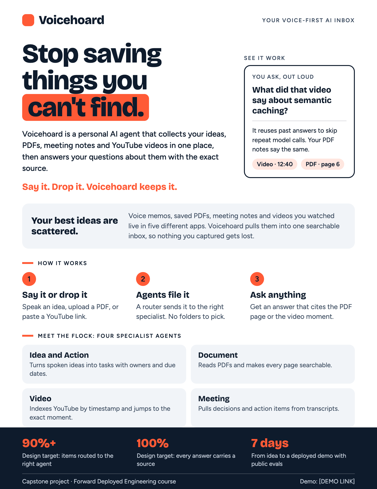

# Voxhoard

**Your voice-first AI inbox.** Say it, drop it, and Voxhoard keeps it.

Voxhoard is a personal AI agent that collects your ideas, PDFs, meeting notes and YouTube videos in one place, then answers your questions about them with the exact source: the PDF page, the meeting line, or the video moment.

> This repository is an overview only. The source code is private.

## The problem

Voice memos, saved PDFs, meeting notes and videos you watched live in different apps. Nothing is connected, and the action items inside them get lost. Voxhoard pulls them into one searchable inbox.

## How it works

1. **Say it or drop it.** Speak an idea, upload a PDF or meeting transcript, or paste a YouTube link. You never pick a folder.
2. **Agents file it.** A router agent classifies each item and hands it to one specialist agent, which summarizes it, tags it, pulls out action items and makes it searchable.
3. **Ask anything.** Ask by voice or text. The answer streams back with citations that open the source at the right page or timestamp.

## The specialist agents

| Agent | What it does |
| --- | --- |
| Idea and Action | Turns spoken ideas into tasks with owners and due dates |
| Document | Reads PDFs and makes every page searchable |
| Meeting | Pulls decisions and action items from transcripts |
| Video | Indexes YouTube videos by timestamp so answers jump to the exact moment |

An ask agent sits on top of the shared store. It decides when to search, combines keyword and semantic search, and only counts an answer as grounded when its citations point at real sources.

## Built with

- **Frontend:** Next.js and TypeScript, hosted on Vercel
- **AI service:** Python, FastAPI and the Claude Agent SDK, hosted on Railway
- **Models:** Claude for routing, extraction and answers; a hosted speech-to-text model for voice
- **Search:** vector search with re-ranking, plus a semantic cache for repeat questions
- **Observability:** OpenTelemetry tracing to Arize
- **Guardrails:** PII masking, prompt-injection screening, spend caps, and a read-only guest role

## Evaluation

Voxhoard was built thresholds-first: success targets were written before the code. On the release eval run:

- **Routing:** 100% of 40 test items went to the right agent (target 90%+)
- **Citations:** every answer on the 12 scorable questions cited a real source
- **Ingest cost:** about $0.02 per item

## About

Capstone project for the Forward Deployed Engineering course. Built with the AAMAD (AI-Assisted Multi-Agent Application Development) framework.
